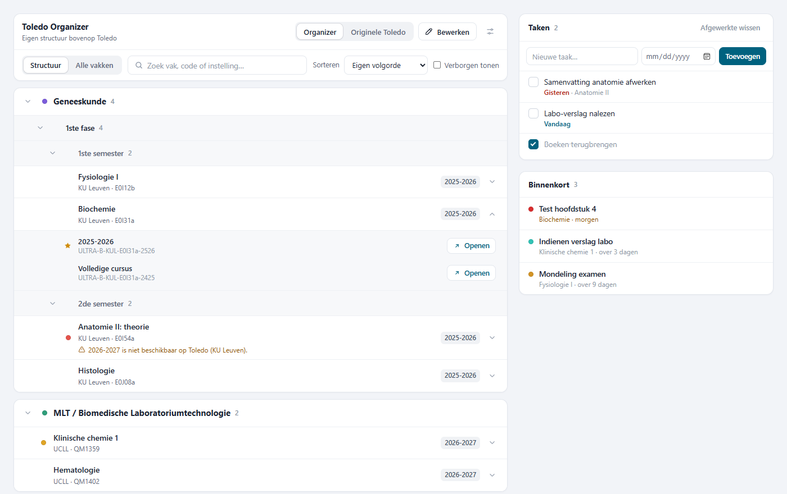
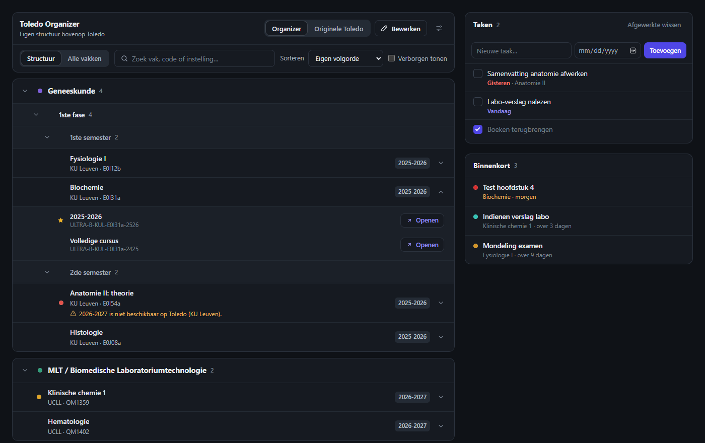
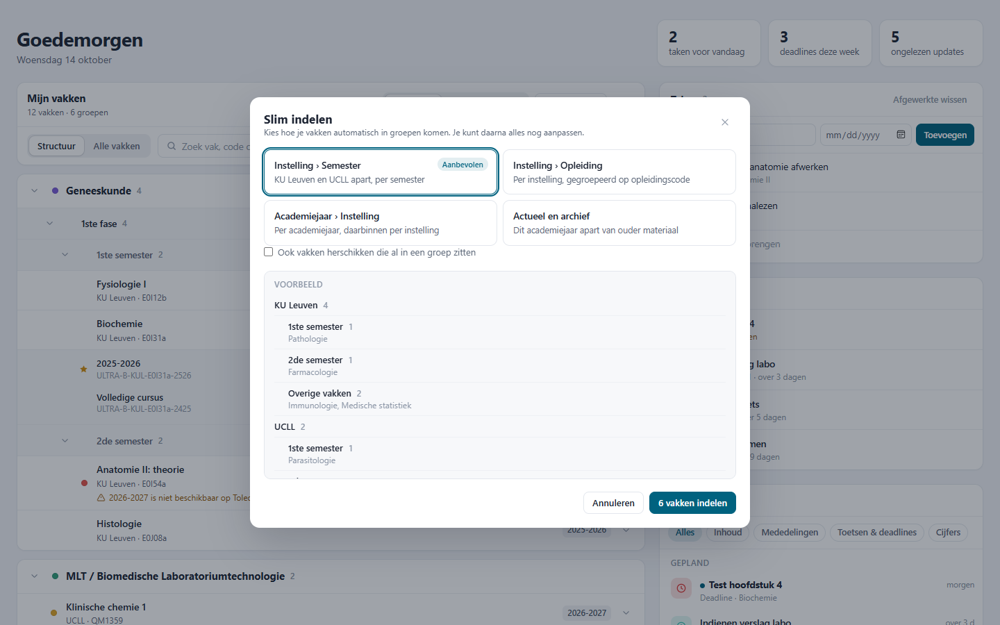
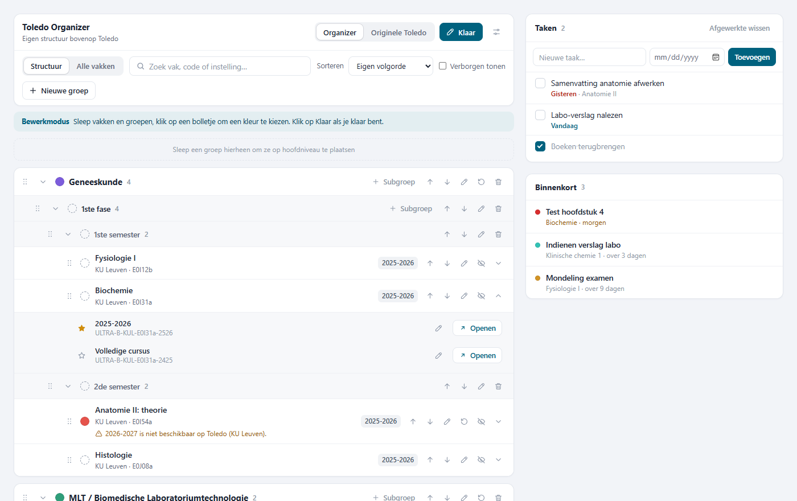

# Toledo Organizer

**Your Toledo home page, organised.** A free browser extension for [Toledo](https://toledo.kuleuven.be) (KU Leuven and UCLL) that sorts your courses into your own groups, merges old academic years, and turns the home page into a calm overview of what's due.

*Available in English and Dutch. Nederlands: [zie verder](#nederlands).*

> **Unofficial.** Made by a student, not affiliated with or endorsed by KU Leuven, UCLL or Anthology (Blackboard). It reads the Toledo page you already see and may need an update when Toledo changes.

## What it does

**Your courses, your structure**
- Groups and subgroups (up to 3 levels), drag and drop for courses and groups
- One card per course: all academic years merged, with a default version that opens on click
- Your own names and colours for courses and groups; hide courses you don't need
- **Slim indelen** (smart sorting): proposes groups by institution, semester, programme code or academic year, with a preview before anything moves
- Search with `/`, sorting, and a one-click switch back to the original Toledo list

**A home page that helps you plan**
- A greeting with today's numbers: tasks due today, deadlines this week, unread updates
- **Taken**: a to-do list right on Toledo, with due dates, overdue and today highlighted (`n` adds a task)
- **Binnenkort**: upcoming deadlines and tests from your Toledo updates, one click away from becoming a task
- **Updates**: Toledo's notifications rewritten (new content, announcement, deadline, test, grade), grouped by day and filterable; opening one still marks it as read in Toledo

**A calmer Toledo**
- A cleaner look for the whole Toledo portal, a wider layout with a sidebar that stays in view
- Light, dark or system mode, and your own accent colour
- English or Dutch, following your Toledo language automatically

## Install

1. Download the `.zip` file from the [latest release](../../releases/latest) and unzip it to a folder you'll keep (for example `Documents\toledo-organizer`).
2. In Microsoft Edge, open `edge://extensions`. (Brave: `brave://extensions`, Opera: `opera://extensions`.)
3. Turn on **Developer mode**.
4. Click **Load unpacked** and pick the unzipped folder (the one with `manifest.json` in it).
5. Open [toledo.kuleuven.be](https://toledo.kuleuven.be). Your courses start under **Niet ingedeeld**; try **Slim indelen** for a first structure.

**Updating:** export your settings first (Settings > Back-up), unzip the new version over the **same** folder, click **Reload** on the extensions page and refresh Toledo. Your settings belong to that folder, so keep using the same one.

## Privacy

Everything stays in your browser. The extension has no server, no analytics and no account, never sees your password, and only runs on `toledo.kuleuven.be`. Your groups, colours and tasks are stored locally and can be exported as a JSON file. Details: [PRIVACY.md](PRIVACY.md).

## Feedback and contributing

Found a bug or have an idea? [Open an issue](../../issues). Pull requests are welcome.

The extension is plain JavaScript with no build step. To work on the UI without Toledo, run `python -m http.server` in the repository root and open `http://localhost:8000/test/demo.html` (add `?edit=1`, `?settings=1`, `?autosort=1` or `?dark=1`). `test/ui-fixture.html` runs a few UI checks and `test/toledo-sim.html` measures how fast the organizer appears on a slow page.

## License

MIT, see [LICENSE](LICENSE).

---

## Nederlands

**Je Toledo-startpagina, eindelijk overzichtelijk.** Een gratis browserextensie voor [Toledo](https://toledo.kuleuven.be) (KU Leuven en UCLL) die je vakken in eigen groepen zet, oude academiejaren samenvoegt en de startpagina een rustig overzicht geeft van wat eraan komt.

> **Niet officieel.** Gemaakt door een student, niet verbonden aan of goedgekeurd door KU Leuven, UCLL of Anthology (Blackboard). De extensie leest de Toledo-pagina die je zelf al ziet en kan een update nodig hebben als Toledo verandert.

### Wat het doet

- **Eigen indeling**: groepen en subgroepen (tot 3 niveaus), slepen en neerzetten, eigen namen en kleuren, vakken verbergen.
- **Eén kaart per vak**: alle academiejaren samen, met een standaardversie die opent als je klikt.
- **Slim indelen**: stelt een indeling voor per instelling, semester, opleidingscode of academiejaar, met een voorbeeld vooraf.
- **Taken**: een takenlijst op Toledo zelf, met deadlines; te laat en vandaag vallen op (sneltoets `n`).
- **Binnenkort**: komende deadlines en toetsen uit je Toledo-updates, met één klik een taak.
- **Updates**: Toledo-meldingen duidelijker verwoord, per dag gegroepeerd en te filteren; openen markeert ze nog steeds als gelezen.
- **Rustiger Toledo**: een strakker uiterlijk, bredere pagina, licht/donker/systeem en je eigen accentkleur.
- **Nederlands of Engels**: volgt automatisch de taal van je Toledo.

### Installeren

1. Download het `.zip`-bestand bij de [laatste release](../../releases/latest) en pak het uit in een map die je bijhoudt.
2. Open in Microsoft Edge `edge://extensions` (Brave: `brave://extensions`, Opera: `opera://extensions`).
3. Zet **Ontwikkelaarsmodus** aan.
4. Klik **Uitgepakte extensie laden** en kies de uitgepakte map (met `manifest.json` erin).
5. Open [toledo.kuleuven.be](https://toledo.kuleuven.be). Je vakken staan eerst onder **Niet ingedeeld**; probeer **Slim indelen** voor een eerste indeling.

**Updaten:** exporteer eerst je instellingen (Instellingen > Back-up), pak de nieuwe versie uit over **dezelfde** map, klik **Opnieuw laden** bij de extensies en vernieuw Toledo.

### Privacy

Alles blijft in je browser: geen server, geen tracking, geen account, nooit je wachtwoord, en de extensie werkt alleen op `toledo.kuleuven.be`. Zie [PRIVACY.md](PRIVACY.md).
